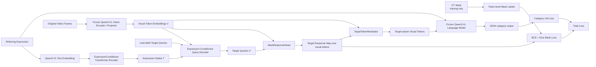
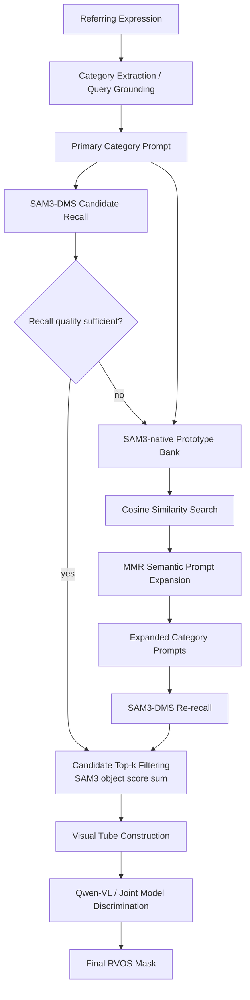
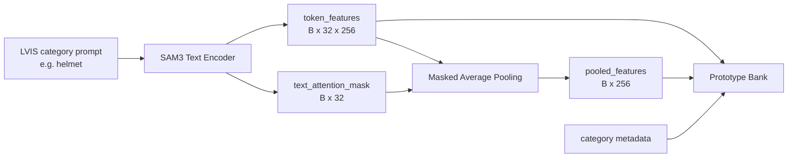
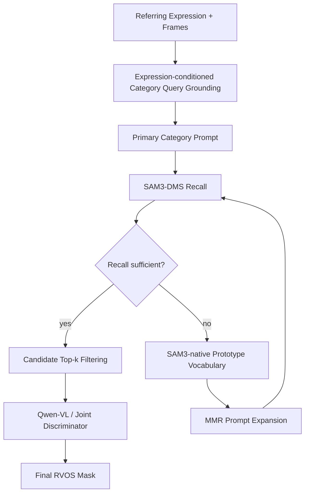

# 类别查询训练方案与 SAM3-native 词库增强方案

本文档用于组会汇报材料整理，覆盖两条当前研究线：

1. **Expression-Conditioned Category Query Grounding**：通过可学习 target query 建模“表达式指向哪个视觉目标”，使类别预测不只依赖数据集类别先验。
2. **SAM3-native Semantic Prompt Expansion**：针对 SAM3 文本提示边界不稳定的问题，构建 SAM3 自身文本空间下的视觉类别词库，并用 MMR 做 prompt-space 语义扩展。

两者解决的问题不同：

- 类别查询训练方案关注 **category 预测是否真正绑定表达式目标**。
- 词库增强方案关注 **SAM3 是否能被一个更合适的视觉类别 prompt 激活**。

---

## 1. 背景问题

当前 RVOS 流程大致是：

```text
Referring Expression
    -> category extraction
    -> SAM3/SAM3-DMS candidate recall
    -> candidate tracking/filtering
    -> Qwen-VL discrimination
    -> final mask
```

我们观察到两个主要瓶颈：

### 1.1 类别提取可能没有真正理解表达式中心目标

例如表达式中同时出现 `hat/person/horse`：

```text
a black hat is being worn by a person riding a horse on the green grass
```

如果模型只靠高频视觉主体或数据集类别先验，可能输出 `person` 或 `horse`，而不是真正需要送给 SAM3 的 `hat`。

这说明仅用 category JSON SFT 存在隐患：监督只告诉模型最终 category，没有强制模型学习“表达式目标和图像区域之间的绑定关系”。

### 1.2 SAM3 对文本 prompt 的响应存在边界问题

即使 category 是正确的，SAM3 也可能召回失败：

```text
category = hat
SAM3("hat")     -> empty / poor recall
SAM3("helmet")  -> correct recall
```

这不是简单的 category 错误，而是 **SAM3 prompt-space mismatch**：某些词在语言上正确，但不一定是 SAM3 最容易响应的视觉提示词。

---

## 2. 类别查询训练方案

### 2.1 设计目标

类别查询训练方案的目标是：让模型从原图和指代表达式中学习一个目标感知的 latent query，再用这个 query 监督视觉 token 的响应区域，并最终辅助 category JSON 输出。

形式上：

```text
expression + original frames -> target-aware visual response -> {"category": "..."}
```

训练阶段使用 GT mask 作为 token-level supervision，但 **不把 mask 图作为输入**。这点很重要：mask 是训练监督，不是推理依赖。

### 2.2 数据构建

对应脚本：

```text
category_grounding_mvp/build_refytvos_query_grounding.py
```

数据来源：

```text
Ref-Youtube-VOS/train/meta_expressions.json
Ref-Youtube-VOS/train/meta.json
Ref-Youtube-VOS/train/mask_dict.pkl
Ref-Youtube-VOS/train/JPEGImages
```

每条训练样本包含：

```text
sample_id
video_id / exp_id / obj_id
expression
category
frame_paths
mask_rles
mask_frame_indices
mask_areas
```

帧选择逻辑：

```text
mask_dict 中找到目标 mask 非空帧
    -> 按面积阈值过滤
    -> 在可见帧中均匀采样 frames_per_sample 帧
```

这样做的原因是：训练监督需要目标确实出现在所选帧里，否则 token-level mask loss 没有意义。

### 2.3 网络结构总览

当前实现对应：

```text
category_grounding_mvp/train_query_grounding_qwen3vl.py
```

核心模块：

- Frozen Qwen3-VL
- ExpressionConditioner
- ExpressionConditionedQueryDecoder
- MaskResponseHead
- TargetTokenModulator
- Category JSON LM head loss

网络图：



### 2.4 模块解释

#### ExpressionConditioner

输入是表达式 token embedding：

```text
expression_input_ids -> embedding -> ExpressionConditioner
```

该模块包含：

- 一个 learnable summary token
- linear projection
- TransformerEncoder
- LayerNorm

输出：

```text
Expression States T
```

作用：把自然语言表达式压缩成可被 query decoder 使用的条件上下文。

#### ExpressionConditionedQueryDecoder

该模块维护一组可学习 target queries：

```text
query_embed: [num_queries, dim]
```

每层 QueryDecoderLayer 包含三步：

```text
1. query self-attention
2. query attends to expression states
3. query attends to visual tokens
4. FFN update
```

直观理解：

```text
query 先形成候选目标假设
    -> 再读取表达式语义
    -> 再到视觉 token 中寻找对应目标
```

#### MaskResponseHead

MaskResponseHead 计算 target query 和每个 visual token 的相似响应：

```text
queries: [B, K, D]
visual:  [B, N, D]

response_logits = queries · visual
```

输出：

```text
response_logits: [B, K, N]
```

其中：

- `K` 是 query 数量。
- `N` 是视觉 token 数。
- 每个 query 都预测一张 token-level response map。

训练时使用 GT mask 下采样到视觉 token 网格，得到：

```text
mask_labels: [B, N]
```

#### Query 匹配与 mask loss

每个 query 都会和 GT token mask 计算一遍 cost：

```text
cost = BCE(response_logits, mask_labels) + Dice(response_logits, mask_labels)
```

然后选择 cost 最低的 query：

```text
k* = argmin_k cost(k)
```

最终 mask loss：

```text
loss_mask = cost(k*)
```

这个机制类似 DETR 的思想：多个 query 提供目标假设，训练时让最匹配 GT 的 query 负责学习。

#### TargetTokenModulator

选中 query 后得到：

```text
selected_response: [B, N]
```

它表示每个视觉 token 属于目标的软响应程度。TargetTokenModulator 用它调制视觉 token：

```text
V_target = V + alpha * response * Adapter(V)
```

这里的残差形式有两个意义：

1. 不破坏 Qwen3-VL 原有视觉表示。
2. 只在模型认为与目标相关的 token 上注入更强的 target-aware 表示。

### 2.5 损失函数

当前训练目标：

```text
Loss = lambda_mask * Loss_mask + lambda_cat * Loss_cat
```

其中：

```text
Loss_mask = BCE + Dice
Loss_cat  = assistant JSON category token loss
```

代码默认参数：

```text
lambda_mask = 1.0
lambda_cat  = 0.5
num_queries = 8
conditioner_layers = 2
decoder_layers = 2
num_heads = 8
mask_dim = 256
modulator_bottleneck = 512
```

训练日志里关注的指标：

```text
loss_mask
loss_cat
mask_soft_dice
mask_target_pos_rate
mask_pred_pos_rate
query_selected_mean
tokens_visual_mean
```

### 2.6 当前方案定位

这条线的意义不是直接替换 SAM3，也不是直接训练分割模型，而是让类别生成具备更强的 expression-target grounding 能力。

它解决的是：

```text
表达式中到底哪个视觉对象应该成为 category prompt？
```

它不能直接解决：

```text
某个正确 category prompt 是否正好能激活 SAM3。
```

这就是为什么还需要第二条线：SAM3-native 词库增强。

---

## 3. SAM3-native 词库增强方案

### 3.1 设计动机

在 RefYTROS val 观察中，我们发现：

```text
category 本身可能正确，但 SAM3 对该词召回失败。
```

典型现象：

```text
Expression: a black hat ...
category: hat

SAM3("hat")     -> empty / poor mask
SAM3("helmet")  -> good mask
```

这说明问题不完全是类别提取错误，而是 SAM3 自身文本空间和视觉检测能力之间存在不稳定边界。

我们需要一种机制：

- 不手写 `hat -> helmet` 规则。
- 不修改 SAM3 权重。
- 不依赖 GT。
- 尽量使用 SAM3 自身已有的语义空间。

因此提出：

```text
SAM3-native Semantic Prompt Expansion
```

### 3.2 整体流程图



这个流程可以理解为：当 primary category 在 SAM3 中召回不足时，系统不是修改 category，而是在 SAM3 自己的视觉类别语义空间里寻找相近但不重复的 prompt，再尝试召回。

### 3.3 词库来源

当前使用 LVIS 类别词构建视觉类别词库：

```text
LVIS category names / synonyms
    -> categories.jsonl
```

构建脚本：

```text
category_grounding_mvp/build_lvis_category_vocab.py
```

输出包含：

```text
source
category_id
name
prompt_text
synset
definition
frequency
instance_count
image_count
variants
```

当前已有两类 prototype bank：

```text
category_grounding_mvp/data/sam3_text_prototypes/lvis_v1
category_grounding_mvp/data/sam3_text_prototypes/lvis_v1_category
```

其中：

- `lvis_v1`：类别名 + synonyms。
- `lvis_v1_category`：只使用 canonical category name。

当前主线使用的是：

```text
category_grounding_mvp/data/sam3_text_prototypes/lvis_v1_category/prototype_bank.pt
```

### 3.4 词库如何经过 SAM3 编码

构建脚本：

```text
category_grounding_mvp/build_sam3_text_prototype_bank.py
```

核心步骤：

```text
prompt_text
    -> SAM3 VETextEncoder
    -> text_memory / text_attention_mask
    -> token_features
    -> pooled_features
```

网络形式：



#### token_features

`token_features` 是 SAM3 text encoder 的 token-level 表示：

```text
token_features: [B, 32, 256]
```

含义：

- `B`：batch size。
- `32`：SAM3 文本 token 序列长度。
- `256`：每个 token 的 hidden dimension。

它更接近 SAM3 实际用于视觉检测/分割的文本条件。

#### pooled_features

`pooled_features` 是我们为了检索构造的类别级向量：

```text
pooled_features: [B, 256]
```

计算方式：

```text
1. 取 token_features
2. 用 text_attention_mask 去除 padding token
3. 对有效 token feature 做平均
4. L2 normalize
```

公式：

```text
pooled = normalize(sum(valid_token_features) / num_valid_tokens)
```

它不是 SAM3 原始推理链路的最终输出，而是从 SAM3 原生 token 表示中提炼出的检索向量。

### 3.5 为什么用 SAM3-native 词库

普通 NLP 词向量回答的是：

```text
这些词在人类语言里是否相似？
```

SAM3-native prototype bank 回答的是：

```text
SAM3 自己把这些视觉类别 prompt 放在什么语义位置？
```

这对当前问题更重要。比如：

```text
hat 和 helmet 不是严格同义词
```

但它们在 SAM3 的视觉类别空间里可能相近，因为都对应“头部佩戴物”的视觉模式。

因此，该词库的作用不是做语言同义词替换，而是建立：

```text
SAM3 自身可感知的视觉类别语义坐标系
```

### 3.6 MMR 语义扩展

扩展器实现：

```text
category_grounding_mvp/sam3_semantic_query_expander.py
```

给定 primary category：

```text
query = "hat"
```

系统在 prototype bank 中计算：

```text
cosine_similarity(pooled_features(query), pooled_features(candidate))
```

如果直接取 top-k，结果可能过于集中：

```text
sunhat
cowboy hat
bowler hat
baseball cap
```

这些都很相关，但语义空间太窄。我们希望候选同时满足：

1. 与原始 category 相关。
2. 彼此不要完全重复。

因此使用 MMR：

```text
MMR(c) = lambda * Sim(c, query)
         - (1 - lambda) * max Sim(c, selected)
```

其中：

- `Sim(c, query)`：候选和原始 category 的相似度。
- `max Sim(c, selected)`：候选和已选候选之间的最大相似度。
- `lambda`：相关性和多样性的权衡。

当前配置中：

```text
diversity_lambda = 0.65
candidate_pool_size = 24
top_k = 4 / 5
min_similarity = 0.55
```

直观理解：

```text
MMR = 相关性 - 重复度
```

### 3.7 hat 样本中的流程

以样本 `4f6662e4e0/0` 为例：

```text
Expression:
a black hat is being worn by a person riding a horse on the green grass
```

类别抽取后：

```text
primary category = hat
```

原始 SAM3 recall：

```text
SAM3("hat") -> empty
```

启动 SAM3-native semantic expansion：

```text
query = hat
prototype bank search + MMR
```

当时的有效扩展包括：

```text
sunhat
beanie
bowler hat
helmet
```

其中：

```text
SAM3("helmet") -> good candidate masks
```

该结果说明：

- `helmet` 不是人工规则写进去的。
- 它是 SAM3 text prototype space + MMR 自然检索得到的视觉近邻。
- 它在 SAM3 中比 `hat` 更容易激活该目标。

### 3.8 与 SAM3-DMS 和 candidate top-k 的关系

当前候选生成侧还有两个重要改进：

```text
SAM3-DMS
candidate_recall_top_k = 24
candidate_keep_top_k = 7
```

含义：

```text
1. 先允许 SAM3-DMS 召回更多候选，提升召回机会。
2. 传播后使用 SAM3 原生 object score sum 保留 top-7。
3. 后续 Qwen-VL / 联合模型只需要在更少、更稳定的候选中精排。
```

这解决的是候选数量和候选质量问题：

```text
几十个 person/bird/duck 候选
    -> 容易让正确候选在精排前被淹没
```

而词库增强解决的是另一个问题：

```text
primary category prompt 本身不能激活 SAM3
```

二者是互补关系。

### 3.9 当前验证方式

当前 RefYTROS val 最佳新方案基底：

```text
crf_sam3_refytros_valid_query_grounding_mainline_20260701
```

指标：

```text
Expression-level:
J   = 64.27
F   = 66.57
J&F = 65.42
num_expressions = 834
```

失败样本定义：

```text
final J&F < 0.5
```

失败样本数：

```text
168 expressions
81 videos
```

当前补丁验证：

```text
top_k = 5
只重跑 J&F < 0.5 的失败样本
其余样本回退到原始 65.42 基底结果
最后做 overlay evaluation
```

对应文件：

```text
category_grounding_mvp/outputs/refytros_valid_mainline_failures_jf_lt_0p5_20260702.json
category_grounding_mvp/outputs/refytros_valid_mainline_failures_jf_lt_0p5_meta_20260702.json
category_grounding_mvp/run_refytros_topk5_failpatch_20260702.sh
category_grounding_mvp/eval_refytros_overlay_png.py
```

这样评估的好处是：

- 不覆盖原始完整结果。
- 只验证补丁是否改善失败样本。
- 最终仍能得到完整 val 的 J/F/J&F。

### 3.10 方案优点与局限

优点：

```text
1. 即插即用，不改 SAM3 权重。
2. 不依赖人工类别映射规则。
3. 使用 SAM3 自己的 text encoder 构建语义空间。
4. 可解释：每次扩展 prompt 都能追踪 similarity 和 MMR 选择。
5. 可以作为失败样本补救机制，也可以作为召回增强机制。
```

局限：

```text
1. 需要额外尝试多个 SAM3 prompt，推理成本增加。
2. 如果扩展 prompt 召回到多个候选，最终仍依赖 Qwen-VL 判别。
3. MMR 只保证语义空间多样性，不保证某个近邻一定是 SAM3 最优 prompt。
4. 如果目标本身超出 SAM3 可分割能力，仅靠 prompt 扩展无法彻底解决。
```

---

## 4. 两条方案之间的关系

可以在 PPT 中这样总结：

```text
类别查询训练方案:
    解决“表达式到底指向什么类别”的问题。

SAM3-native 词库增强方案:
    解决“正确类别词是否能激活 SAM3”的问题。
```

整体框架：



这两条线共同服务于最终目标：

```text
提高 SAM3 初始候选质量，
减少候选过多和 prompt 失配导致的召回失败，
让后续 Qwen-VL / 联合训练精排更容易选出正确目标。
```

---

## 5. PPT 建议

建议组会 PPT 放 5 页：

### Page 1: 问题观察

标题：

```text
SAM3 candidate generation is sensitive to category prompts
```

内容：

```text
hat -> empty
helmet -> correct
```

说明这不是简单类别提取错误，而是 SAM3 prompt-space mismatch。

### Page 2: 类别查询训练方案

放第 2.3 节网络图，强调：

```text
expression-conditioned target query
mask-supervised token response
category JSON output
```

### Page 3: SAM3-native 词库构建

放第 3.4 节词库构建图，强调：

```text
LVIS visual nouns
-> SAM3 text encoder
-> token_features / pooled_features
-> SAM3-native prototype bank
```

### Page 4: MMR Semantic Prompt Expansion

放公式和 `hat -> helmet` 案例：

```text
MMR(c) = lambda * relevance - (1-lambda) * redundancy
```

说明 `helmet` 是从 SAM3-native 语义空间中检索出来的，不是人工规则。

### Page 5: 当前实验进展

写：

```text
RefYTROS val baseline:
J=64.27, F=66.57, J&F=65.42

Failure patch:
J&F < 0.5 samples: 168 expressions
semantic expansion top_k: 5
overlay evaluation in progress
```

最后总结：

```text
The method improves candidate generation before ranking,
which is the main bottleneck of the current RVOS pipeline.
```

